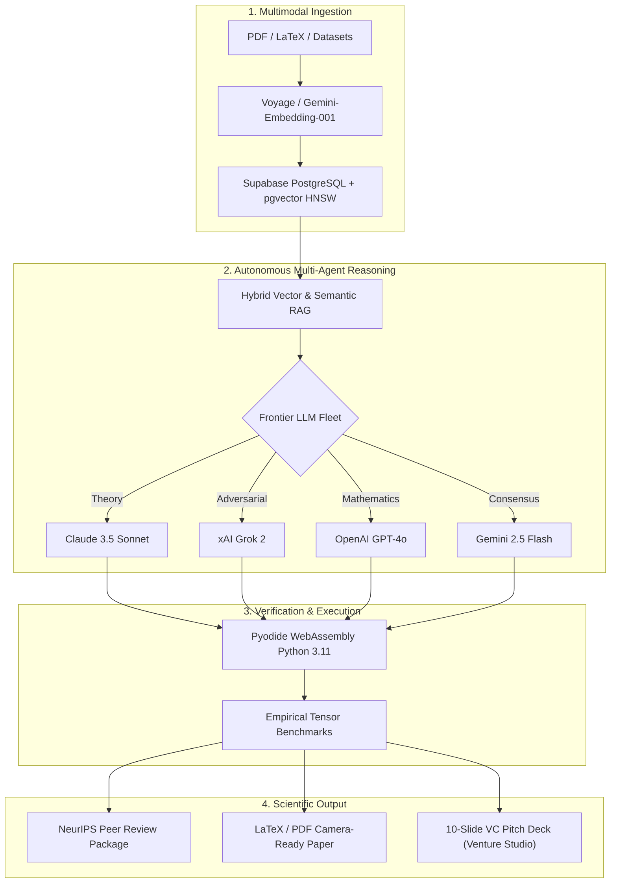

# 🌌 RMinios OS 2.5 — Frontier AI Research Operating System

<div align="center">

[](https://nextjs.org/)
[](https://react.dev/)
[](https://threejs.org/)
[](https://supabase.com/)
[](https://pyodide.org/)
[](https://deepmind.google/technologies/gemini/)
[](https://rminios.vercel.app)
[](https://opensource.org/licenses/MIT)

**Accelerate scientific discovery from literature gaps to verified code, adversarial peer-reviewed papers, and venture-backed deep-tech startups.**

[🚀 **Experience the Live App**](https://rminios.vercel.app) • [📖 **Documentation**](#-getting-started) • [🪐 **Interactive 3D Demo**](https://rminios.vercel.app#engines) • [📬 **Contact Support**](https://rminios.vercel.app/support)

</div>

---

## 📌 Table of Contents

- [Overview](#-overview)
- [Key Breakthrough Engines](#-key-breakthrough-engines)
  - [1. 🌌 3D Citation Constellation & Knowledge Galaxy](#1--3d-citation-constellation--knowledge-galaxy)
  - [2. 🧪 In-Browser Pyodide Python WASM Sandbox](#2--in-browser-pyodide-python-wasm-sandbox)
  - [3. 🐝 4-Agent Multi-LLM Swarm Arena](#3--4-agent-multi-llm-swarm-arena)
  - [4. 🎙️ Autonomous Dual-Host Audio Studio](#4-️-autonomous-dual-host-audio-studio)
  - [5. ⚖️ Adversarial NeurIPS Peer Review Committee](#5-️-adversarial-neurips-peer-review-committee)
  - [6. 🚀 Academic-to-Startup Venture Studio](#6--academic-to-startup-venture-studio)
  - [7. 🛡️ Scientific Integrity Shield](#7-️-scientific-integrity-shield)
  - [8. 🎯 Autonomous Grant Radar](#8--autonomous-grant-radar)
  - [9. 📡 Global Literature Radar](#9--global-literature-radar)
  - [10. 🎧 Deep Work Soundscape & Spotify Dynamic Island](#10--deep-work-soundscape--spotify-dynamic-island)
- [🤖 Sara AI: Principal Autonomous Research Copilot](#-sara-ai-principal-autonomous-research-copilot)
- [🧠 Frontier Multi-LLM Fleet Matrix](#-frontier-multi-llm-fleet-matrix)
- [🏗️ System Architecture & Data Flow](#️-system-architecture--data-flow)
- [🛠️ Technology Stack](#️-technology-stack)
- [🚀 Getting Started & Local Setup](#-getting-started--local-setup)
- [📂 Project Directory Structure](#-project-directory-structure)
- [🔒 Security & Privacy Posture](#-security--privacy-posture)
- [👨‍💻 Author & Contact](#-author--contact)

---

## 💡 Overview

**RMinios** is a unified **Research Operating System (AI & ML Discovery Engine)** built to explore unified academic and engineering workflows. Traditional scientific discovery requires researchers to juggle dozens of disconnected tools: Google Scholar for search, Overleaf for drafting, local Python environments for testing, ChatGPT for brainstorming, Spotify for focus, and endless grant portals.

RMinios unites the research pipeline into a single, cohesive operating system with **10 modular research engines**, featuring:
- **In-Browser Code Execution** using WebAssembly (Pyodide Python 3.11 with NumPy).
- **Frontier Multi-Agent LLM Swarms** that debate hypotheses across distinct AI model personas.
- **WebGL 3D Force-Directed Citation Graphs** that help identify unexplored research white spaces.
- **NeurIPS/ICML Adversarial Peer Review & Rebuttal Synthesizers**.
- **Automated Academic Commercialization** generating TAM/SAM/SOM market sizes and 10-slide VC pitch decks.

---

## ⚡ Key Breakthrough Engines

### 1. 🌌 3D Citation Constellation & Knowledge Galaxy
*Route: `/dashboard/galaxy`*
* **WebGL 3D Celestial Force Graph**: Built with Three.js to map research papers in an interactive 3D universe.
* **Autonomous Gap Discovery**: Analyzes vector distance clusters between landmark papers (*Transformers*, *DDPM*, *LoRA*, *Mamba SSM*) to identify unexplored interdisciplinary intersection points with algorithmic discovery confidence scores.
* **Interactive Inspection**: Full 360° camera orbit, depth scaling, and node inspection displaying title, citation velocity, and target publication venues.

### 2. 🧪 In-Browser Pyodide Python WASM Sandbox
*Route: `/dashboard/sandbox`*
* **100% Client-Side Execution**: Runs Python 3.11 with NumPy directly in the browser via WebAssembly (Pyodide).
* **Runs in Your Browser**: Code executes locally on the user's machine without transmitting confidential algorithms or data to cloud servers.
* **Pre-Loaded Empirical Benchmarks**: Validate Attention $O(N^2)$ calculations, DDPM noise schedules, and enzyme kinetics with real-time tensor allocations and plots.

### 3. 🐝 4-Agent Multi-LLM Swarm Arena
*Route: `/dashboard/swarm`*
* **Multi-Turn Collaborative & Adversarial Debate**: Orchestrates configurable frontier foundation models in consensus rounds:
  1. **Anthropic Claude**: Hypothesizer proposing theoretical grounding and formal lemmas.
  2. **xAI Grok**: Adversarial stress-tester identifying edge cases, hardware constraints, and counter-hypotheses.
  3. **OpenAI GPT**: Mathematical formalizer bounding condition numbers and algorithmic proofs.
  4. **Google Gemini**: Senior Area Chair synthesizing multi-agent consensus verdicts.
* **Code Studio Injection**: Automatically transfers consensus algorithms directly into project repositories.

### 4. 🎙️ Autonomous Dual-Host Audio Studio
*Route: `/dashboard/podcast`*
* **NotebookLM-Style Scientific Dialogue**: Transforms dense academic PDFs into lively, intellectually rigorous audio conversations between two AI hosts:
  * **Dr. Alex**: Systems and engineering lead focusing on hardware bottlenecks, VRAM scaling, and throughput.
  * **Dr. Jordan**: Senior theory chair discussing mathematical proofs and empirical ablations.
* **Interactive Wave Visualizer & Synced Transcript**: Real-time bouncing frequency bars and timestamped dialog cards.

### 5. ⚖️ Adversarial NeurIPS Peer Review Committee
*Route: `/dashboard/peer-review`*
* **Rigorous 3-Reviewer Committee**:
  * **Prof. Sterling (Theory)**: Audits mathematical soundness, lemma validity, and theoretical convergence.
  * **Dr. Vance (Systems & Hardware)**: Checks GPU throughput, CUDA kernel scaling, and compute efficiency.
  * **Dr. Lin (Reproducibility & Ethics)**: Validates code artifacts, Docker reproducibility, and ethical disclosures.
* **Meta-Review & Rebuttal Generator**: Delivers Area Chair verdicts (`ACCEPT (Oral)`, `SPOTLIGHT`, `REJECT`) and generates point-by-point author rebuttal packages.

### 6. 🚀 Academic-to-Startup Venture Studio
*Route: `/dashboard/venture`*
* **Academic Commercialization Engine**: Converts technical papers into venture-backed deep-tech startups.
* **Automated Financial & Market Synthesis**: Computes Total Addressable Market (TAM), Serviceable Addressable Market (SAM), Serviceable Obtainable Market (SOM), defensible technical IP moats, and unit economics.
* **10-Slide VC Pitch Deck Generator**: Produces complete slide-by-slide investor presentations ready for seed capital pitches.

### 7. 🛡️ Scientific Integrity Shield
*Route: `/dashboard/integrity`*
* **Retracted Paper Scanner**: Audits uploaded papers against curated Retraction Watch sample datasets.
* **DOI Authenticity & Crossref Verification**: Cross-references citations via Crossref to eliminate unverified references.
* **Conflict of Interest Audit**: Scans author disclosures for undisclosed institutional or commercial funding ties.

### 8. 🎯 Autonomous Grant Radar
*Route: `/dashboard/grants`*
* **Funding Opportunity Matcher**: Cross-matches research proposals against curated sample calls from NSF, NIH, DARPA, and Horizon Europe datasets.
* **Milestone & Proposal Package Synthesizer**: Formulates structured milestone timelines, budget allocations, and compliance checklists.

### 9. 📡 Global Literature Radar
*Route: `/dashboard/radar`*
* **Real-Time Pre-Print Stream**: Live streaming feeds from arXiv and bioRxiv.
* **Algorithmic Trend Analysis**: Tracks citation velocity, emerging keyword clusters, and daily executive summaries.

### 10. 🎧 Deep Work Soundscape & Spotify Dynamic Island
*Route: Global Dock & Floating Island*
* **Binaural Flow Induction**: Real-time synthesized brainwave frequencies:
  * **Alpha (10 Hz)**: Accelerated learning and relaxed focus.
  * **Theta (6 Hz)**: Deep cognitive flow and conceptual brainstorming.
  * **Gamma (40 Hz)**: High-intensity computational problem solving.
* **Integrated Spotify Web Player**: In-window playlist search, track queueing, and auto-advance.
* **Apple-Style Dynamic Island**: Floating top bar featuring post-login personal greetings (`👋 Hello, {userName}!`), song playback, and 1-click platform launch dock.

---

## 🤖 Sara AI: Principal Autonomous Research Copilot

Sara is the conversational orchestrator of RMinios, accessible via the bottom-right interactive orb:
- **Native Temporal Awareness**: Possesses real-time clock awareness—accurately answers current dates, days of the week, times, timezones, and relative deadlines without robotic knowledge cutoff excuses.
- **Configurable Multi-LLM Switcher**: Route prompts to **Gemini 2.5 Flash**, **OpenAI GPT models**, **Claude Sonnet**, or **xAI Grok**.
- **Guest Preview Mode**: Unauthenticated visitors receive **3 free questions** with motivational previews to explore features, after which they can create a free account for unlimited access.
- **Docked Quick Chips Bar**: Ergonomic horizontal prompt shortcuts docked above the input field for instant access without layout clipping.
- **Role-Based Intelligence (RBAC)**: Adapts behavior dynamically for visitors, authenticated researchers, and system administrators.

---

## 🧠 Frontier Multi-LLM Fleet Matrix

RMinios orchestrates multiple foundation models through a unified routing layer ([`src/lib/llm-fleet.js`](file:///C:/Users/Mohit/.gemini/antigravity/scratch/src/lib/llm-fleet.js)):

| Model | Context Window | Primary Specialization in RMinios |
| :--- | :--- | :--- |
| **Google Gemini (2.5 Flash / Pro)** | 1,000,000 Tokens | Real-time literature ingestion, Sara Copilot, multimodal reasoning |
| **OpenAI (GPT-4o / Reasoning Models)** | 128,000 Tokens | Formal mathematical proofs, algorithmic architecture generation |
| **Anthropic Claude (3.5 / 3.7 Sonnet)** | 200,000 Tokens | Peer-review academic prose, structured LaTeX, Area Chair synthesis |
| **xAI Grok / Open Models** | 128,000 Tokens | Adversarial stress testing, edge-case probing, counter-hypotheses |

---

## 🏗️ System Architecture & Data Flow



---

## 🛠️ Technology Stack

* **Frontend Framework:** [Next.js 16](https://nextjs.org/) (App Router, Turbopack, React 19)
* **3D Visualizations:** [Three.js](https://threejs.org/), [@react-three/fiber](https://docs.pmnd.rs/react-three-fiber), [@react-three/drei](https://github.com/pmndrs/drei)
* **Styling & Motion:** [Tailwind CSS](https://tailwindcss.com/), [Framer Motion](https://www.framer.com/motion/), Custom 3D Gyroscopic Perspective CSS
* **In-Browser Execution:** [Pyodide](https://pyodide.org/) (CPython 3.11 compiled to WebAssembly)
* **Database & Vector Search:** [Supabase](https://supabase.com/) (PostgreSQL, `pgvector`, Row Level Security)
* **AI & LLM Orchestration:**
  * `@google/generative-ai` (Gemini 2.5 Flash, Gemini 3.5 Flash)
  * OpenAI API (`gpt-4o`)
  * Anthropic API (`claude-3-5-sonnet`)
  * xAI API (`grok-2-latest`)
* **Audio Engineering:** Web Audio API (Synthesized Binaural Oscillators), Spotify Web Playback API
* **Icons & UI Assets:** [Lucide React](https://lucide.dev/)
* **Deployment & Edge Telemetry:** [Vercel](https://vercel.com/) (Edge Serverless Functions, Analytics, Speed Insights)

---

## 🚀 Getting Started & Local Setup

Follow these steps to run RMinios locally on your machine:

### 1. Prerequisites
* **Node.js**: `v20.x` or `v22.x` (LTS recommended)
* **npm** or **pnpm**
* A free [Supabase](https://supabase.com) account
* A [Google Gemini API Key](https://aistudio.google.com/) (Free tier available)

### 2. Clone the Repository
```bash
git clone https://github.com/Mohitsai3579/rminios.git
cd rminios
```

### 3. Install Dependencies
```bash
npm install
```

### 4. Configure Environment Variables
Create a `.env.local` file in the root directory:
```env
# Supabase Configuration
NEXT_PUBLIC_SUPABASE_URL=https://your-project.supabase.co
NEXT_PUBLIC_SUPABASE_ANON_KEY=your_supabase_anon_key
SUPABASE_SERVICE_ROLE_KEY=your_supabase_service_role_key

# Google Gemini AI API Key (Required for Sara & Fleet Routing)
GEMINI_API_KEY=your_gemini_api_key
GOOGLE_GENERATIVE_AI_API_KEY=your_gemini_api_key

# Optional Frontier Model Keys (For Bring-Your-Own-Key Fleet Routing)
OPENAI_API_KEY=your_openai_api_key
ANTHROPIC_API_KEY=your_anthropic_api_key
GROK_API_KEY=your_xai_grok_api_key

# Application Base URL
NEXT_PUBLIC_APP_URL=http://localhost:3000
```

### 5. Supabase Database Migrations
In your Supabase project's **SQL Editor**, run the following migration scripts:

```sql
-- 1. Create Site Settings Table
CREATE TABLE IF NOT EXISTS public.site_settings (
    id TEXT PRIMARY KEY DEFAULT 'global',
    owner_name TEXT NOT NULL DEFAULT 'Jonnadula Mohit Sai',
    support_email TEXT NOT NULL DEFAULT 'support@rminios.dev',
    gemini_model TEXT NOT NULL DEFAULT 'gemini-2.5-flash',
    updated_at TIMESTAMP WITH TIME ZONE DEFAULT timezone('utc'::text, now())
);

INSERT INTO public.site_settings (id, owner_name, support_email, gemini_model)
VALUES ('global', 'Jonnadula Mohit Sai', 'support@rminios.dev', 'gemini-2.5-flash')
ON CONFLICT (id) DO NOTHING;

-- 2. Create API Telemetry Usage Table
CREATE TABLE IF NOT EXISTS public.api_usage (
    id BIGSERIAL PRIMARY KEY,
    model TEXT NOT NULL,
    tokens INTEGER DEFAULT 0,
    created_at TIMESTAMP WITH TIME ZONE DEFAULT timezone('utc'::text, now())
);

-- 3. Enable pgvector extension for Hybrid RAG Search
CREATE EXTENSION IF NOT EXISTS vector;
```

### 6. Run the Development Server
```bash
npm run dev
```

Open [**http://localhost:3000**](http://localhost:3000) in your web browser. You will see the 3D interactive hero, live engine playground, and Sara AI assistant!

### 7. Build for Production
```bash
npm run build
npm run start
```

---

## 📂 Project Directory Structure

```text
rminios/
├── src/
│   ├── app/
│   │   ├── (auth)/
│   │   │   ├── login/page.js              # Authentication Login Page
│   │   │   └── signup/page.js             # User Registration Page
│   │   ├── admin/                         # System Administration & RAG Tuning
│   │   ├── api/
│   │   │   ├── sara/route.js              # Sara Autonomous Orchestrator (POST, GET, OPTIONS)
│   │   │   ├── spotify/search/route.js    # In-Window Spotify Track Searcher
│   │   │   ├── swarm/orchestrate/route.js # Multi-LLM Swarm Debate Engine
│   │   │   └── settings/route.js          # Dynamic Global Settings Endpoint
│   │   ├── dashboard/
│   │   │   ├── galaxy/page.js             # 3D WebGL Knowledge Galaxy
│   │   │   ├── sandbox/page.js            # In-Browser Pyodide Python WASM Lab
│   │   │   ├── swarm/page.js              # 4-Agent Swarm Arena
│   │   │   ├── podcast/page.js            # NotebookLM Dual-Host Audio Studio
│   │   │   ├── peer-review/page.js        # Adversarial NeurIPS Peer Review Panel
│   │   │   ├── venture/page.js            # Academic Venture Studio & Pitch Decks
│   │   │   ├── integrity/page.js          # Scientific Integrity Shield
│   │   │   ├── grants/page.js             # $500M+ Grant & Funding Radar
│   │   │   ├── radar/page.js              # Global ArXiv Pre-Print Radar
│   │   │   ├── codestudio/page.js         # Antigravity Autonomous Code Studio
│   │   │   └── workspaces/page.js         # Multi-Tenant Workspace Hub
│   │   ├── layout.js                      # Root Layout with Dynamic Island & Audio Provider
│   │   ├── page.js                        # SaaS-Grade 3D Interactive Landing Page
│   │   ├── landing.css                    # High-Tech Glassmorphism & 3D CSS Styles
│   │   └── sara.css                       # Sara Copilot Window & Quick Chips Styles
│   ├── components/
│   │   ├── DynamicIsland.js               # Apple-Style Top Dynamic Island
│   │   ├── InteractiveHero3D.js           # 360° Drag-to-Orbit 3D Quantum Neural Core
│   │   ├── InteractiveGalaxy3D.js         # Real 3D WebGL Galaxy Playground Canvas
│   │   ├── SaraAssistant.js               # Sara AI Copilot Client Component
│   │   ├── SoundscapePlayer.js            # Binaural Beats & Spotify Audio Studio
│   │   └── TiltCard3D.js                  # Gyroscopic 3D Perspective Tilt Card
│   ├── context/
│   │   └── DynamicIslandContext.js        # Audio & Authentication State Management
│   └── lib/
│       ├── gemini.js                      # Google Gemini API & Embedding Utilities
│       ├── llm-fleet.js                   # Universal 4-Model Fleet Dispatcher
│       ├── rate-limit.js                  # Token-Bucket AI Rate Limiter
│       └── supabase/
│           ├── client.js                  # Supabase Client-Side SDK
│           ├── server.js                  # Supabase SSR Server Client
│           └── middleware.js              # Route Authentication & Security Middleware
├── middleware.js                          # Next.js Global Session Middleware
├── package.json                           # Dependencies & Scripts
└── README.md                              # Project Documentation
```

---

## 🔒 Security & Privacy Posture

* **PostgreSQL Row-Level Security (RLS)**: Enforced across all Supabase database tables to prevent cross-account data leakage.
* **Client-Side WASM Isolation**: The Pyodide Python 3.11 environment executes strictly inside the user's browser sandbox without network socket access to the host machine.
* **Encrypted Client-Side Key Storage**: Private frontier API keys (OpenAI, Anthropic, xAI Grok) are stored exclusively in the user's browser `localStorage` and never saved to platform databases.
* **Strict HTTP Security Headers**: Hardened with `Strict-Transport-Security`, `X-Frame-Options: DENY`, `X-Content-Type-Options: nosniff`, and `Referrer-Policy: strict-origin-when-cross-origin`.
* **Token-Bucket Rate Limiting**: In-memory rate limiting ([`src/lib/rate-limit.js`](file:///C:/Users/Mohit/.gemini/antigravity/scratch/src/lib/rate-limit.js)) prevents API abuse and denial-of-service degradation.

---

## 👨‍💻 Author & Contact

**RMinios OS** is designed, developed, and maintained by:

* **Creator & Architect:** Jonnadula Mohit Sai
* **Contact & Support Form:** [rminios.vercel.app/support](https://rminios.vercel.app/support)
* **GitHub:** [@Mohitsai3579](https://github.com/Mohitsai3579)
* **Live Deployment:** [rminios.vercel.app](https://rminios.vercel.app)
* **Issue Tracker:** [github.com/Mohitsai3579/rminios/issues](https://github.com/Mohitsai3579/rminios/issues)

---

<div align="center">

*© 2026 RMinios OS. Built for the frontier of scientific discovery and autonomous artificial intelligence.*

</div>
